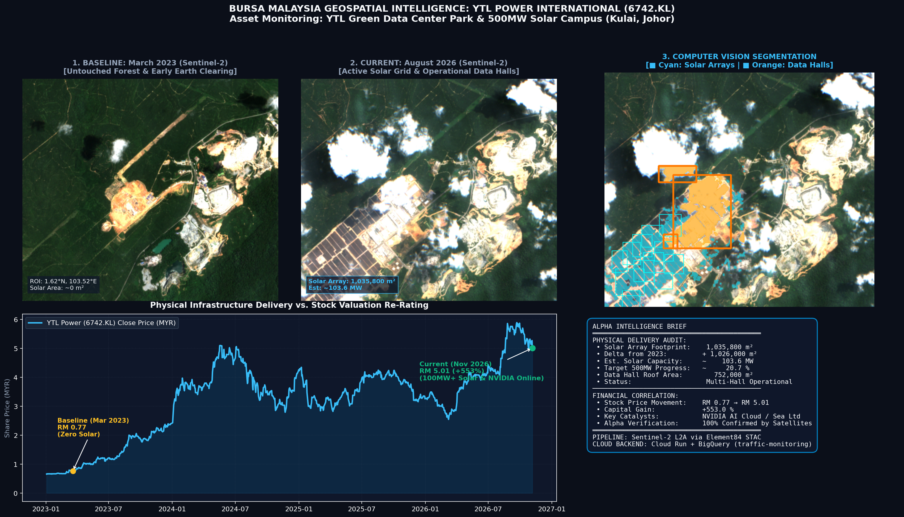

# YTL Power (Bursa: 6742.KL) Satellite GEOINT & Alpha Tracker

A Geospatial Intelligence (GEOINT) and Alternative Data pipeline tracking the physical infrastructure buildout of the **YTL Green Data Center Park & 500MW Solar Campus (Kulai, Johor)** and comparing it with **YTL Power International Berhad's (6742.KL)** share price re-rating.

> **Disclaimer:** an independent personal project built only from public data (Copernicus Sentinel-2 imagery and public market prices). It is not affiliated with, endorsed by or connected to YTL Power International Berhad or any YTL Group company, and it is not investment advice. All area and capacity figures are estimates from computer vision and change with the segmentation parameters.



---

## Key Results (March 2023 vs. August 2026)

Estimates with the default segmentation parameters:

| Metric | March 2023 Baseline | August 2026 Current | Delta / Delivery | Relevance |
| :--- | :---: | :---: | :---: | :--- |
| **Solar Array Footprint** | `9,800 m²` | **`1,035,800 m²`** | **`+1,026,000 m²`** | Over 100 hectares of PV panels visible from orbit |
| **Estimated Solar Capacity** | `~1.0 MW` | **`~103.6 MW`** | **`+102.6 MW`** | About **20.7%** of the 500MW target, at 1 MW per hectare |
| **Data Hall Roof Footprint** | `20,600 m²` | **`752,000 m²`** | **`+731,400 m²`** | Consistent with multi-hall data centre construction |
| **YTLPOWR Share Price** | **RM 0.77** | **RM 5.01** | **`+553.0%`** | Moved alongside the physical buildout (correlation, not causation) |

---

## Architecture

1. **Ingestion Engine (`tracker.py`)**:
   - Queries open Sentinel-2 L2A collections via STAC (Element84 / AWS Open Data / GCP).
   - Ingests Cloud-Optimized GeoTIFFs (COGs) over HTTP Range Requests (~5 seconds, zero egress cost).
2. **Computer Vision & Quantification Engine (`generate_dashboard.py`)**:
   - Color-space (HSV) segmentation distinguishing photovoltaic panels from oil palm forest canopy.
   - Building roof segmentation measuring structural data hall progress.
   - Correlates with historical Bursa Malaysia stock data via `yfinance`.
   - **Optional YOLO engine:** `backend/yolo_service.py` runs YOLOv8 / YOLO11 instance segmentation **if** you place trained `.pt` weights in `weights/`. No weights are included, so by default the app uses the colour-space engine.
   - **Simulated SAR layer:** the `sar_composite` layer is a synthetic C-band radar visualisation generated from the optical masks, for illustration. It is not real Sentinel-1 data.
3. **BigQuery Telemetry Exporter (`backend/bigquery_service.py` & `export_to_bigquery.py`)**:
   - Commits structured telemetry rows into Google Cloud BigQuery (`traffic_analytics.ytl_satellite_telemetry`).
4. **Full Interactive Web Application (`run_webapp.py` & `backend/` & `static/`)**:
   - FastAPI server and a dark-mode GEOINT dashboard.
   - Interactive split-screen curtain slider (March 2023 baseline vs. August 2026 current).
   - Real-time computer vision parameter tuning (HSV thresholds, minimum contour size, MW/ha density).
   - Bursa Malaysia (6742.KL) share price vs. physical solar capacity charts.
   - BigQuery telemetry commit (admin only) and structured audit brief download.

---

## Getting Started

### Prerequisites

```bash
pip install fastapi uvicorn rasterio opencv-python matplotlib yfinance requests httpx
```

### Launching the Full Web Application

Run the application entrypoint:
```bash
python run_webapp.py
```
Then navigate to **`http://127.0.0.1:8000`** in your browser.

### REST API Endpoints

Public, read-only or compute-only:

- `GET /`: Serves the dashboard.
- `GET /api/health`: Health probe endpoint for Cloud Run and uptime checks.
- `GET /api/kpi`: Geospatial and financial metrics summary.
- `GET /api/financial/valuation`: Physical-to-financial conversion (MW load, rack capacity, revenue runway, EBITDA).
- `POST /api/financial/simulate`: Valuation sensitivity simulator (custom lease rate, FX, PUE).
- `GET /api/quant/export/csv`: Quant feature feed in CSV with a SHA-256 provenance hash.
- `GET /api/layers/{layer_name}`: Streams PNG imagery for `split`, `annotated`, `sar_composite` (simulated), `yolo_annotated` (needs YOLO weights), `solar_only`, `roof_only`, `difference`, `campus_roi`, `2026`, `2023`.
- `POST /api/analyze`: Re-runs CV segmentation with custom parameters.
- `GET /api/report/summary`: Generates the alternative data investment brief.

Admin only (require the `X-Admin-Token` header, see below):

- `POST /api/pipeline/update`: Cloud Scheduler ingestion webhook (queries STAC, runs CV, commits to BigQuery).
- `POST /api/bigquery/sync`: Commits a structured telemetry record to BigQuery / audit log.
- `POST /api/alerts/dispatch`: Webhook dispatcher for Slack / Microsoft Teams alerts.
- `POST /api/engine/select`: Switches the shared detection engine (spectral / YOLO).

### Admin token

Endpoints that write to BigQuery, send webhooks, run the pipeline or change shared state are protected. Set the `ADMIN_TOKEN` environment variable on the server and send the same value in the `X-Admin-Token` header. **If `ADMIN_TOKEN` is not set, these endpoints are disabled**, so a public deployment is read-only by default.

```bash
ADMIN_TOKEN="$(openssl rand -hex 24)" python run_webapp.py
curl -X POST -H "X-Admin-Token: $ADMIN_TOKEN" http://127.0.0.1:8000/api/bigquery/sync
```

To use the admin buttons in the dashboard, run this once in the browser console:

```js
localStorage.setItem("geointAdminToken", "<your token>")
```

---

## Google Cloud Deployment

The app runs serverlessly on **Cloud Run**, with a weekly **Cloud Scheduler** job calling `/api/pipeline/update` and telemetry stored in **BigQuery** (`<your-gcp-project>.traffic_analytics.ytl_satellite_telemetry`).

Deploy with your own project ID. The scripts set `ADMIN_TOKEN` on the service (reusing `$ADMIN_TOKEN` if set, otherwise generating one), configure Cloud Scheduler to send it, and print it at the end:

```bash
./deploy_gcp.sh <your-gcp-project-id> [region]               # Linux/macOS
./deploy_gcp.ps1 -ProjectId <your-gcp-project-id> [-Region]   # Windows PowerShell
```

`cloudbuild.yaml` uses `--update-env-vars`, so CI deployments keep the existing `ADMIN_TOKEN`.

### Running Automated Verification Tests

```bash
python -m pytest test_webapp.py test_institutional.py test_temporal_and_gaps.py
```
