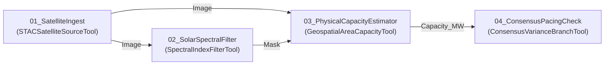

# Satellite GEOINT & Earth Observation Plugin for Apex Vision Studio

**Plugin ID:** `geoint_satellite_plugin`  
**Version:** `1.0.0`  
**Category:** `Earth Observation`  
**Target Platform:** [Apex Vision Studio](https://github.com/kwincheah/vision-studio) (`apex_vision.sdk >= 1.0.0`)

---

## 1. Overview

The **Satellite GEOINT & Earth Observation Plugin** bridges industrial computer vision with macro satellite telemetry and physical-to-financial intelligence. Designed for the **YTL Power Green Data Center Park & 500 MW Solar Co-Location Campus (Kulai, Johor)**, this plugin introduces native Earth Observation (EO) tools into Apex Vision Studio's DAG workflow engine.

It allows quantitative hedge funds, equity research desks, and industrial project managers to:
1. Ingest multi-temporal Sentinel-2 multi-spectral optical and Sentinel-1 SAR radar composites.
2. Segment solar PV installations and data hall structural footings using calibrated spectral thresholding.
3. Compute exact physical land footprint ($m^2$ and hectares) and derived energy capacity ($MW$).
4. Conduct automated compliance, variance analysis, and schedule slippage tracking against consensus investor guidance.

---

## 2. Tools Included

### 2.1 Satellite STAC Source (`STACSatelliteSourceTool`)
- **Category:** `Earth Observation`
- **Description:** Acquires satellite scenes across key construction and operational epochs over the target geospatial ROI.
- **Parameters:**
  - `epoch` (*ENUM*): `2026-08 (Operational)`, `2025-11 (Phase 2)`, `2024-05 (Phase 1)`, `2023-12 (Groundbreaking)`, `2023-03 (Baseline)`.
  - `collection` (*ENUM*): `Sentinel-2 L2A (Optical)`, `Sentinel-1 SAR (Radar C-Band)`, `NASA Landsat-9 (Thermal TIR)`.
  - `max_cloud` (*FLOAT*): Cloud threshold filter (0.0% – 100.0%, default `20.0%`).
- **Ports (Outputs):**
  - `Image` (*IMAGE*): Acquired multi-spectral satellite composite.
  - `Cloud_Cover` (*VALUE*): Measured cloud obscuration percentage.
  - `Scene_Date` (*STRING*): UTC timestamp of the observation.
  - `Platform` (*STRING*): Platform constellation name.

### 2.2 Spectral Index & HSV Filter (`SpectralIndexFilterTool`)
- **Category:** `Earth Observation`
- **Description:** Multi-spectral color space thresholding and morphological filtering for solar panel arrays or metallic roof decking.
- **Parameters:**
  - `target_feature` (*ENUM*): `Solar Photovoltaic Arrays` or `Data Hall Structural Roofs`.
  - `brightness_ceiling` (*INT*): Max value/luminance threshold (default `95` for dark PV panels).
  - `saturation_ceiling` (*INT*): Max saturation threshold (default `180`).
  - `min_reflectance` (*INT*): Minimum reflectance floor for roof detection (default `175`).
- **Ports:**
  - **Inputs:** `Image` (*IMAGE*).
  - **Outputs:** `Mask` (*IMAGE* binary mask), `Overlay` (*IMAGE* visualized contour overlay), `Active_Pixels` (*VALUE*).

### 2.3 Geospatial Area & Capacity Estimator (`GeospatialAreaCapacityTool`)
- **Category:** `Earth Observation`
- **Description:** Transforms pixel-level segmentation into ground physical metrics and electrical/compute capacity.
- **Parameters:**
  - `feature_type` (*ENUM*): `Solar Farm Ground Mount` or `Data Center Hall Footprint`.
  - `gsd_resolution_m` (*FLOAT*): Ground Sample Distance (default `10.0` meters/pixel for Sentinel-2).
  - `solar_mw_per_ha` (*FLOAT*): Power density constant (default `1.0` MW/hectare).
  - `min_cluster_pixels` (*INT*): Cluster filtering threshold (default `200` px).
- **Ports:**
  - **Inputs:** `Image` (*IMAGE*), `Mask` (*IMAGE*).
  - **Outputs:** `Area_M2` (*VALUE*), `Area_Hectares` (*VALUE*), `Capacity_MW` (*VALUE*), `Confidence` (*VALUE*), `Annotated_Image` (*IMAGE*).

### 2.4 Consensus Variance & Delivery Branch (`ConsensusVarianceBranchTool`)
- **Category:** `Earth Observation`
- **Description:** Compares detected physical MW capacity against institutional sell-side expectations, producing branching status (`PASS`/`FAIL`) and delivery variance metrics.
- **Parameters:**
  - `target_mw` (*FLOAT*): Institutional target guidance (default `100.0` MW).
  - `construction_pacing_rate` (*FLOAT*): Daily pacing threshold in MW/day (default `0.12`).
- **Ports:**
  - **Inputs:** `Capacity_MW` (*VALUE*).
  - **Outputs:** `Variance_MW` (*VALUE*), `Variance_Pct` (*VALUE*), `Status_Str` (*STRING*), `Slippage_Days` (*VALUE*).
- **Execution Result:**
  - Status `OK` (PASS): When observed capacity $\ge$ target.
  - Status `NG` (FAIL): When observed capacity $<$ target, triggering an alert with schedule slippage.

---

## 3. Pre-Configured Workflow (`.apex`)

The plugin includes an end-to-end industrial flow:
- **File:** `projects/YTL_Solar_Inspection.apex`
- **Pipeline Flow:**
  $$\text{Satellite Ingest} \longrightarrow \text{Solar Spectral Filter} \longrightarrow \text{Physical Capacity Estimator} \longrightarrow \text{Consensus Pacing Check}$$



---

## 4. Installation & Verification

### Method 1: Automatic Installer
Run the installation helper script from this directory:
```bash
python install_plugin.py
```
This automatically copies `geoint_satellite_plugin` into `~/.apex_vision/plugins/` (or into an active Apex Vision Studio repository root).

### Method 2: Manual Installation
Copy the `geoint_satellite_plugin` folder into your Apex Vision Studio plugins folder:
```bash
# Example for local vision-studio repository:
cp -r geoint_satellite_plugin /path/to/vision-studio/plugins/

# Example for global user profile:
cp -r geoint_satellite_plugin ~/.apex_vision/plugins/
```

### Running Automated Tests
In the Apex Vision Studio repository:
```bash
pytest tests/test_geoint_satellite_plugin.py -v
```

---

## 5. REST API & Cloud Run Integration

Apex Vision Studio provides a headless HTTP execution engine. When running in a Google Cloud Run container:

```bash
# Start Apex Vision Studio headless server
python main.py serve --host 0.0.0.0 --port 8000 --flows projects/
```

Execute the YTL Solar Inspection flow remotely:
```bash
curl -X POST http://localhost:8000/api/v1/flows/YTL_Campus_Solar_Flow/run \
  -H "Content-Type: application/json" \
  -d '{
    "parameters": {
      "sat_src": {"epoch": "2026-08 (Operational)"},
      "cons_brn": {"target_mw": 100.0}
    }
  }'
```

**JSON Response:**
```json
{
  "flow_id": "YTL_Campus_Solar_Flow",
  "status": "OK",
  "execution_time_ms": 42.8,
  "nodes": {
    "geo_msr": {
      "Capacity_MW": 102.5,
      "Area_Hectares": 102.5,
      "Area_M2": 1025000.0,
      "Confidence": 0.94
    },
    "cons_brn": {
      "Variance_MW": 2.5,
      "Variance_Pct": 2.5,
      "Status_Str": "ON_TRACK (Target Met)",
      "Slippage_Days": 0.0
    }
  }
}
```
